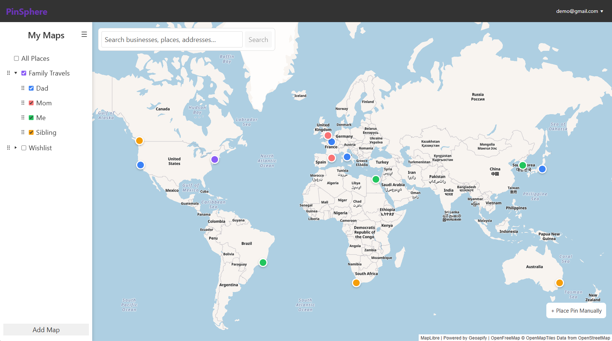

# PinSphere

PinSphere is a collaborative mapping application for organizing places into maps and submaps, saving location pins, and sharing collections with role-based permissions.

**[Live Demo: https://mypinsphere.vercel.app/](https://mypinsphere.vercel.app/)**



*Example map with sample data.*

## Features

- **Interactive maps and submaps:** Organize places into a hierarchy and control which collections appear on the map.
- **Custom pins:** Save names, notes, and locations, with a single pin belonging to multiple maps or submaps. Add pins manually or from search results.
- **Location search:** Find places with Geoapify autocomplete and explicit search, preview a result on the map, and turn it into a saved pin.
- **Personal organization:** Drag to reorder maps and sibling submaps, choose preset or custom colors, and use personal ordering to determine marker-color priority.
- **User accounts:** Email/password authentication, session restoration, and account-synced appearance and basemap preferences with a local cache.
- **Sharing and collaboration:** Invite collaborators as Editors or Viewers. Owners manage collaborator roles and removal; members can view collaborators or leave shared maps.
- **Permission-aware deletion:** Delete a pin's connections to maps and submaps you can edit while preserving protected connections.
- **Responsive interface:** Keyboard-accessible dialogs, menus, search, and pin markers, with Light, Dark, and System appearance independent of five basemap styles.

## Technical Highlights

- **Authentication and authorization:** Supabase Auth manages sessions. PostgreSQL row-level security and RPC checks enforce database permissions alongside role-aware frontend controls.
- **Shared pin relationships:** Pin records and map/submap memberships are modeled separately. The deletion RPC removes authorized connections transactionally and deletes an unconnected pin only when permitted.
- **Save recovery:** Uncertain pin edits retain drafts and block retries until fresh reads verify the saved state. Recovery rebases membership changes to avoid repeating already-committed inserts. Unconfirmed pin creation blocks immediate retries; deletion recovery refreshes state without automatically repeating the write.
- **Account persistence:** Preferences initialize from local settings when no profile exists, handle competing initialization attempts, and serialize subsequent updates. Personal sidebar ordering is stored separately from shared map ordering.
- **Search and mapping interactions:** Debounced, cancellable search includes stale-response protection, timeouts, caching, and deduplication. Search and manual placement share a pin-creation flow, with overlays that adapt to the sidebar and viewport.

## Tech Stack

| Area | Technologies |
| --- | --- |
| Frontend | React, JavaScript, CSS, React Router |
| Mapping | MapLibre GL JS, `@vis.gl/react-maplibre`, OpenFreeMap basemaps |
| Search | Geoapify autocomplete and forward geocoding |
| Backend | Supabase Auth, PostgreSQL, row-level security, PL/pgSQL RPCs |
| Drag and drop | dnd-kit |
| Build and quality | Vite, ESLint, Node.js built-in test runner |
| Deployment | Vercel |

## Local Development

**Backend prerequisite:** Local development requires an existing, configured PinSphere-compatible Supabase backend, including its tables, constraints, RLS policies, triggers, and RPCs. The SQL files in [`supabase/`](supabase/) are **incremental changes, not a complete database bootstrap**. They are not applied automatically by the application or build. Review their prerequisites before using them with another database.

With Node.js and npm installed:

1. Install dependencies:

   ```sh
   npm install
   ```

2. Create `.env.local` in the project root:

   ```dotenv
   VITE_SUPABASE_URL=your-supabase-project-url
   VITE_SUPABASE_KEY=your-supabase-publishable-or-anon-key
   VITE_GEOAPIFY_API_KEY=your-geoapify-api-key
   ```

   Use a client-safe Supabase publishable or anon key, never a service-role key. `VITE_` variables are included in the browser bundle; `.env.local` is ignored by Git. Configure the Geoapify key to allow your development and deployment origins. Without it, search is unavailable, but manual pin placement remains available.

3. Start the development server and open the URL printed by Vite:

   ```sh
   npm run dev
   ```

## Testing and Build

```sh
node --test tests/*.test.mjs
npm run lint
npm run build
```

The tests cover authentication form behavior, permissions-related client operations, invitations, personal ordering, search request handling, preferences, and pin-save/deletion recovery. They use mocks where appropriate; live Supabase authorization and transaction behavior require separate integration testing.

The production build is written to `dist/`. Run `npm run preview` to serve it locally.
